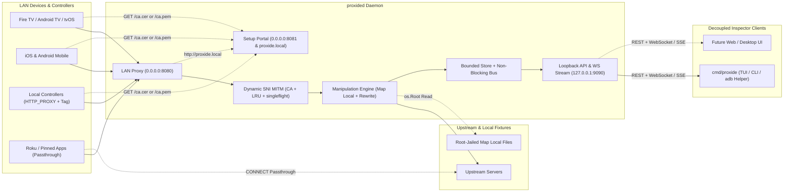

# Proxide

**Proxide** is a multi-device LAN HTTP/HTTPS MITM proxy daemon and decoupled traffic inspector written in **Go (`go1.27+`)**. It splits the headless network proxy, dynamic SNI certificate authority, and manipulation engine (`proxided`) cleanly from thin inspector clients (`proxide` CLI/TUI, or future web/desktop UIs) over a loopback REST + WebSocket/SSE `CaptureEvent` API.

First-class target devices include **Fire TV**, **Android TV**, **Android mobile**, **iOS**, **tvOS**, and **custom local controllers** (`HTTP_PROXY`/`HTTPS_PROXY` + `X-Proxide-Client`). **Roku** and **certificate-pinned apps** are supported on a best-effort basis via per-host/per-client TLS passthrough and pin-failure surfacing.

> **Current Stage:** Architecture & coding-standards baseline (`Phase 0` documentation complete; awaiting review before Phase 1 implementation).

---

### Planned Repository Layout

- `cmd/proxided` — Headless proxy daemon composition root (LAN proxy listener, local setup portal, dynamic SNI MITM TLS, bounded store, manipulation engine, and loopback API).
- `cmd/proxide` — Thin inspector CLI/TUI and `adb` proxy helper communicating strictly over the loopback REST + WebSocket/SSE API.
- `internal/model` — Pure immutable domain contracts (`CaptureEvent`, `ClientIdentity`, `StreamFrame`, `RewriteRule`, `ApiError`) and typed enums.
- `internal/config` — Typed configuration structs, centralized limits/constants, and validation.
- `internal/clientreg` — Source IP normalization (`netip.Addr.Unmap()`), `X-Proxide-Client` tag extraction, friendly name aliases, and best-effort ARP/MAC resolution.
- `internal/ca` — Persistent on-disk ECDSA P-256 Root CA (`0700`/`0600`), PEM/DER encoding, SHA-256 fingerprint, and Apple/Android-compliant SAN leaf certificate signing.
- `internal/tlsmitm` — `tls.Config.GetCertificate` manager with bounded LRU (`2048`), `singleflight` per SNI, TLS passthrough allowlist, and pin-failure detection.
- `internal/rewrite` — Pure rule matcher, root-jailed `os.Root` Map Local responder, and header/body rewriter.
- `internal/portal` — Embedded (`embed.FS`) zero-JS LAN Setup Portal with pure User-Agent device detection and read-only `.pem`/`.cer`/`.der`/`.crt` CA endpoints (`0.0.0.0:8081` & `http://proxide.local`).
- `internal/proxy` — LAN HTTP forward proxy (RFC 9110), `CONNECT` tunnel/MITM handoff, WebSocket/SSE frame capture, and flow timing.
- `internal/store` & `internal/bus` — Dual-bounded flow ring buffer (`5000` flows / `256 MiB`) and non-blocking pub/sub event fan-out.
- `internal/api` — Loopback-only (`127.0.0.1:9090`) Control & Inspector REST + WebSocket/SSE server.
- `internal/archtest` — Automated `go/packages` dependency-boundary and hygiene fitness tests.

### Planned Commands (Post-Bootstrap)

Once `Phase 1` begins after documentation review, standard Go workflows will run with:

- Build daemon and inspector binaries: `go build ./...`
- Run full test suite with race detector: `go test -race ./...`
- Run static analysis and architecture fitness checks: `go vet ./...` and `golangci-lint run`
- Run proxy daemon / thin inspector: `go run ./cmd/proxided` and `go run ./cmd/proxide`

---

### Documentation & Architecture

- [Coding Standards](./CODING_STANDARDS.md) — Universal engineering pillars, Go language/runtime rules, proxy/TLS/API contracts, and universal anti-patterns.
- [Go-Specific Pitfalls & Remedies](./docs/go-pitfalls.md) — Dedicated catalog (`GP-01`–`GP-34`) of Go-unique type, memory, concurrency, `net/http`, `crypto/tls`, and JSON traps kept separate from universal rules.
- [Architecture Decision Records (ADRs)](./docs/architecture-decisions.md) — Recorded rationale and trade-offs (`ADR 1`–`ADR 10`).
- [Master Architecture Plan & Phase Tracker](./docs/01_PLAN.md) — Phased build order (`Phase 1`–`Phase 4`), network/package/sequence diagrams, wire contracts, and verification gates.

### Target Architecture Overview

