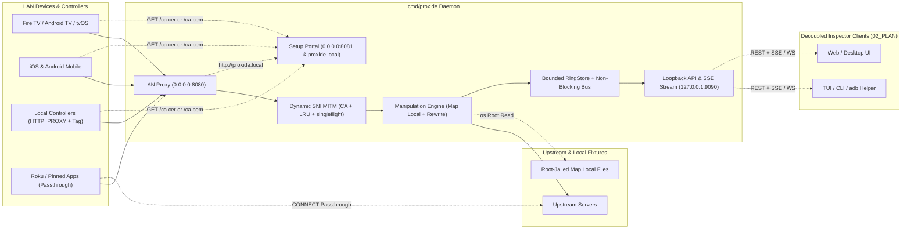

# Proxide

**Proxide** is a multi-device LAN HTTP/HTTPS MITM proxy daemon and decoupled traffic inspection engine written in **Go (`go1.27+`)** using the Go standard library. It isolates the headless network proxy, dynamic SNI certificate authority, manipulation engine, and bounded capture bus (`cmd/proxide`) behind a loopback-only REST + SSE `CaptureEvent` stream so TUI, web, or desktop inspector UIs ([docs/02_PLAN.md](./docs/02_PLAN.md)) can be built or swapped without touching TLS or proxying code.

First-class target devices include **Fire TV**, **Android TV**, **Android mobile**, **iOS**, **tvOS**, and **custom local controllers** (`HTTP_PROXY`/`HTTPS_PROXY` + `X-Proxide-Client`). **Roku** and **certificate-pinned apps** are supported on a best-effort basis via per-host/per-client TLS passthrough and pin-failure surfacing.

---

### Repository Layout

- [`./cmd/proxide`](./cmd/proxide) — Proxy daemon composition root (LAN proxy listener `:8080`, setup portal `:8081`, dynamic SNI MITM TLS, bounded store & event bus, manipulation engine, and loopback API `127.0.0.1:9090`).
- [`./internal/model`](./internal/model) — Pure immutable domain contracts (`CaptureEvent`, `ClientIdentity`, `StreamFrame`, `RewriteRule`, `ApiError`) and typed enums.
- [`./internal/config`](./internal/config) — Typed configuration structs, centralized limits/constants, LAN interface discovery, and validation.
- [`./internal/clientreg`](./internal/clientreg) — Source IP normalization (`netip.Addr.Unmap()`), `X-Proxide-Client` tag extraction, friendly name aliases, and best-effort ARP/MAC resolution.
- [`./internal/ca`](./internal/ca) — Persistent on-disk ECDSA P-256 Root CA (`0700`/`0600`), PEM/DER encoding, SHA-256 fingerprint, and Apple/Android-compliant SAN leaf certificate signing.
- [`./internal/tlsmitm`](./internal/tlsmitm) — `tls.Config.GetCertificate` manager with bounded LRU (`2048`), stdlib `singleflight` per SNI, TLS passthrough allowlist, and pin-failure detection.
- [`./internal/rewrite`](./internal/rewrite) — Pure rule matcher, root-jailed `os.Root` Map Local responder, and header/body rewriter (`Interceptor` & `RuleStore` interfaces).
- [`./internal/portal`](./internal/portal) — Embedded (`embed.FS`) zero-JS LAN Setup Portal with pure User-Agent device detection and read-only `.pem`/`.cer`/`.der`/`.crt` CA endpoints (`0.0.0.0:8081` & `http://proxide.local`).
- [`./internal/proxy`](./internal/proxy) — LAN HTTP forward proxy (RFC 9110), `CONNECT` tunnel/MITM handoff, SSE/upgrade support, and flow timing.
- [`./internal/bus`](./internal/bus) — Dual-bounded flow ring buffer (`RingStore`, `5000` flows / `256 MiB`) and non-blocking pub/sub event fan-out (`Bus`).
- [`./internal/api`](./internal/api) — Loopback-only (`127.0.0.1:9090`) Control & Inspection REST + SSE stream server.
- [`./internal/archtest`](./internal/archtest) — Automated `go/parser` package-boundary and hygiene fitness tests.

### Building, Testing & Running

- Build daemon binary: `go build ./...`
- Run unit, loopback MITM E2E, SSE, and architecture fitness tests with race detector: `go test -race -count=1 ./...`
- Run static checks and formatting check: `go vet ./...` and `gofmt -l cmd internal`
- Run proxy daemon: `go run ./cmd/proxide` (or pass `--iface en0`, `--map-local-root ./fixtures`, `--passthrough "*.roku.com"`)

---

### Documentation & Architecture

- [Coding Standards](./CODING_STANDARDS.md) — Universal engineering pillars, Go language/runtime rules, proxy/TLS/API contracts, and universal anti-patterns.
- [Go-Specific Pitfalls & Remedies](./docs/go-pitfalls.md) — Dedicated catalog (`GP-01`–`GP-35`) of Go-unique type, memory, concurrency, `net/http`, `crypto/tls`, and JSON traps kept separate from universal rules.
- [Architecture Decision Records (ADRs)](./docs/architecture-decisions.md) — Recorded rationale and trade-offs (`ADR 1`–`ADR 10`).
- [Master Architecture Plan & Phase Tracker](./docs/01_PLAN.md) — Milestone 1 & Milestone 2 engine/API architecture, contracts, and phase tracker.
- [UI, Inspector Client & Tooling Plan](./docs/02_PLAN.md) — TUI/Web/Desktop inspector roadmap, `adb` CLI helpers, and hook tooling.

### Target Architecture Overview

