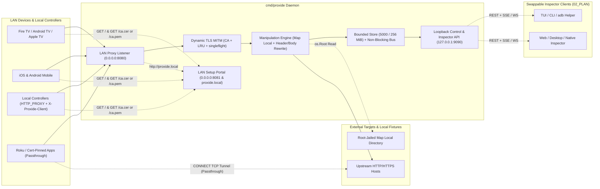
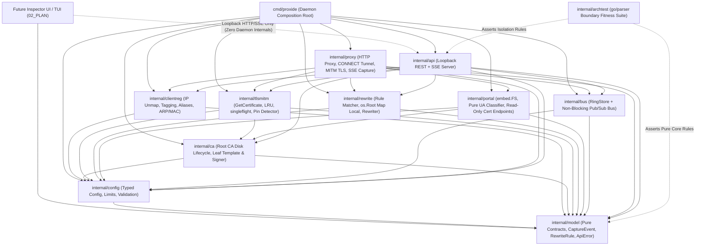
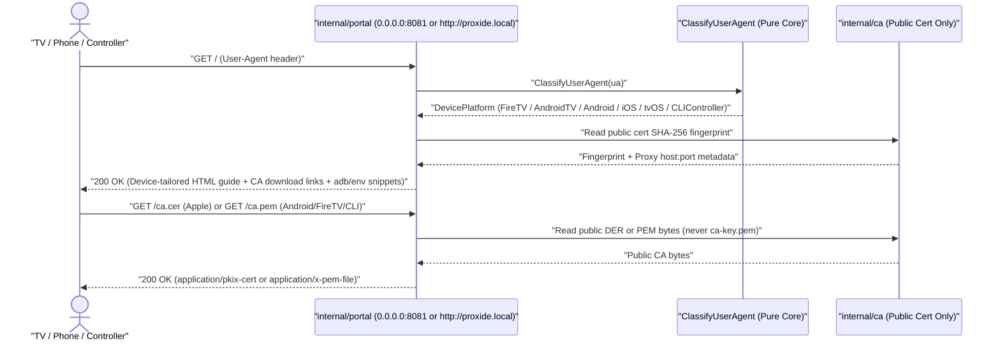

# Proxide — Master Architecture Plan & Phase Tracker

> **Maintenance Rule:** Update this tracker whenever a phase or milestone finishes: check off completed `- [x]` tasks, update the **Status** (`Not Started` -> `In Progress` -> `Done`) and **Completed Date** columns in the dashboard below, and record any architectural refinements in [architecture-decisions.md](architecture-decisions.md) before modifying code. Every file and rule must follow [CODING_STANDARDS.md](../CODING_STANDARDS.md) and avoid the Go-specific hazards tracked in [go-pitfalls.md](go-pitfalls.md).
>
> Inspector TUI/Web UIs, interactive rule builders, `adb` CLI helpers, and hook tooling are tracked in **[02_PLAN.md](02_PLAN.md)**.

---

## Phase Progress Dashboard

| Phase | Build Order Mapping | Scope | Status | Key Verification Gate | Completed Date |
| :--- | :--- | :--- | :--- | :--- | :--- |
| **Phase 1** | Foundation | `go.mod` (Go 1.27 pure stdlib), `.gitignore`, pure contracts (`internal/model`, `internal/config`), & `internal/archtest` | Done | `go build ./...`, `go vet ./...`, `go test -race ./internal/config ./internal/archtest` pass | 2026-11-21 |
| **Phase 2** | **Build Order 1** | LAN HTTP forward proxy + HTTPS `CONNECT` tunnel + `ClientRegistry` (IP unmap, `X-Proxide-Client`, friendly names, best-effort ARP/MAC) + structured `slog` + `cmd/proxide` daemon | Done | `go test -race ./...`, loopback HTTP fidelity (`302`, `gzip`) + `CONNECT` half-close & zero-leak tests pass | 2026-11-21 |
| **Phase 3** | **Build Order 2** | Persistent ECDSA P-256 Root CA (`internal/ca`), Local Setup Portal (`internal/portal` — UA classifier + `.pem`/`.cer`/`.der`/`.crt` + `http://proxide.local`), Dynamic SNI Leaf Signing + MITM TLS + Passthrough (`internal/tlsmitm`) | Done | CA `0700`/`0600` & `<= 397d` SAN policy tests, LRU+`singleflight` concurrency tests, loopback MITM E2E + UA fuzz tests pass | 2026-11-21 |
| **Phase 4** | **Build Order 3 (Engine & API Core)** | Bounded ring-buffer store & non-blocking event bus (`internal/bus`), loopback Control/Inspection REST + SSE stream (`internal/api`), and Manipulation Engine (`internal/rewrite` — root-jailed `os.Root` Map Local + Header/Body Rewrite) | Done (UI moved to `02_PLAN`) | Full `go test -race -count=1 ./...`, Map Local path-jail & rewrite `Content-Length` tests, SSE stream & strict JSON tests pass | 2026-11-21 |

---

## Locked-In Decisions Summary

| Area | Locked-In Choice | Rationale & Rules |
| :--- | :--- | :--- |
| **Coding Standards** | Universal pillars (pure transforms, immutability, CQS, zero magic numbers) + idiomatic Go + separate Go pitfalls catalog | [CODING_STANDARDS.md](../CODING_STANDARDS.md) · [go-pitfalls.md](go-pitfalls.md) · [ADR 1](architecture-decisions.md#adr-1-universal-coding-standards-go-idiom-adaptation-and-separate-go-pitfalls-registry) |
| **Language & Runtime** | Go 1.27+ (`net/http`, `crypto/tls`, `crypto/x509`, `net/netip`, `log/slog`, goroutines), pure stdlib core with zero third-party deps in Milestones 1–2 | [ADR 2](architecture-decisions.md#adr-2-go-stdlib-first-runtime-over-kotlinjvm-and-rust-for-the-proxy-daemon) |
| **System Shape** | Decoupled `cmd/proxide` daemon emitting immutable `CaptureEvent`s over loopback REST + SSE stream (`GET /api/v1/events/stream`) for future TUI/Web UIs ([02_PLAN.md](02_PLAN.md)) | [ADR 3](architecture-decisions.md#adr-3-decoupled-proxy-daemon-and-inspector-client-over-loopback-rest-and-websocket-stream) |
| **Security Boundary** | LAN Proxy (`0.0.0.0:8080`) + Read-Only Portal (`0.0.0.0:8081` & `http://proxide.local`) vs. Loopback-Only Control API (`127.0.0.1:9090`) | [ADR 4](architecture-decisions.md#adr-4-dual-network-exposure-and-security-boundary) |
| **LAN & Client Tagging** | `--listen` / `--iface`, `netip.Addr.Unmap()`, `X-Proxide-Client` tag extraction & upstream strip, friendly aliases & best-effort ARP/MAC | [ADR 5](architecture-decisions.md#adr-5-lan-listener-source-ip-normalization-controller-tagging-and-client-registry) |
| **Dynamic MITM TLS** | Persistent ECDSA P-256 Root CA (`0700`/`0600`), short-lived SAN leaf certs (`7d`, `<= 397d`, `-5m` clock skew), LRU (`2048`) + `singleflight`, passthrough + pin failure detection | [ADR 6](architecture-decisions.md#adr-6-dynamic-mitm-tls-architecture-and-passthrough-detection) |
| **Local Setup Portal** | `embed.FS` templates, pure `ClassifyUserAgent` (`FireTV`/`AndroidTV`/`Android`/`iOS`/`tvOS`/`CLIController`), `.pem`/`.cer`/`.der`/`.crt` CA endpoints | [ADR 7](architecture-decisions.md#adr-7-local-setup-portal-user-agent-classifier-and-multi-format-ca-downloads) |
| **Target Devices** | First-class Fire TV, Android TV, Android mobile, iOS, tvOS & custom local controllers; best-effort Roku & cert-pinned apps via passthrough | [ADR 8](architecture-decisions.md#adr-8-target-device-strategy-and-known-constraints) |
| **Store, Bus & Rewrite** | Bounded store (`5000` flows / `256 MiB`), `1 MiB` body capture cap, drop-oldest `internal/bus`, root-jailed `os.Root` Map Local & header/body rewrite | [ADR 9](architecture-decisions.md#adr-9-bounded-capture-store-non-blocking-event-fan-out-and-manipulation-pipeline) |
| **Verification & QA** | `go test -race ./...`, native `Fuzz*` targets, loopback MITM E2E tests, `internal/archtest` (`go/parser`), `go vet ./...` | [ADR 10](architecture-decisions.md#adr-10-layered-verification-strategy-and-architecture-fitness-tests) |

---

## Architectural Diagrams

### 1. System & Network Exposure Topology



### 2. Go Package Dependency Graph



### 3. Dynamic MITM TLS, Manipulation & Event Fan-Out Sequence

```mermaid
sequenceDiagram
    actor Device as "LAN Device (e.g. Fire TV / iOS)"
    participant Proxy as "internal/proxy (:8080)"
    participant ClientReg as "internal/clientreg"
    participant MITM as "internal/tlsmitm + internal/ca"
    participant Rewrite as "internal/rewrite"
    participant Upstream as "Upstream HTTPS Server"
    participant StoreBus as "internal/bus (RingStore + Bus)"
    participant Inspector as "Inspector Client (127.0.0.1:9090)"

    Device->>Proxy: "CONNECT api.example.com:443"
    Proxy->>ClientReg: "Normalize RemoteAddr via netip.Addr.Unmap()"
    ClientReg-->>Proxy: "ClientIdentity (IP, FriendlyName, MAC)"
    Proxy->>MITM: "Check passthrough allowlist for (client, host)"
    alt Passthrough Host / Pinned App
        Proxy->>Upstream: "Dial TCP"
        Proxy-->>Device: "200 Connection Established (Raw Tunnel)"
    else MITM Intercepted
        Proxy-->>Device: "200 Connection Established + TLS Server Handshake"
        Device->>MITM: "ClientHello (SNI = api.example.com)"
        MITM->>MITM: "Lookup LRU; on miss, singleflight sign SAN leaf (<= 397d)"
        MITM-->>Device: "Serve Leaf Cert + Root CA Chain"
        Device->>Proxy: "Encrypted HTTP Request (+ optional X-Proxide-Client)"
        Proxy->>Rewrite: "Match request rules (Map Local / Header & Body Rewrite)"
        alt Map Local Rule Matched
            Rewrite-->>Proxy: "Root-jailed local fixture response + AppliedManipulation"
        else Forward Upstream
            Proxy->>Upstream: "Transport.RoundTrip (DisableCompression: true)"
            Upstream-->>Proxy: "Upstream HTTP Response"
            Proxy->>Rewrite: "Apply response rules & reconcile Content-Length"
        end
        Proxy-->>Device: "HTTP Response"
        Proxy->>StoreBus: "Append immutable CaptureEvent & non-blocking Publish"
        StoreBus-->>Inspector: "Push JSON event over SSE /api/v1/events/stream"
    end
```

### 4. Local Setup Portal Device Onboarding Sequence



---

## API, Event & Rule Contract Summary

### Structured `CaptureEvent` Wire Schema (`internal/model`)

Every completed or streaming flow emits an immutable JSON object conforming to this contract:

```json
{
  "id": "flow_01934...",
  "timestamp": "2026-11-21T10:52:00Z",
  "client": {
    "ip": "192.168.1.42",
    "tag": "firetv-living-room",
    "friendly_name": "Living Room Fire TV",
    "mac": "aa:bb:cc:dd:ee:ff",
    "platform": "fire_tv"
  },
  "protocol": "https",
  "request": {
    "method": "POST",
    "url": "https://api.example.com/v1/playback",
    "host": "api.example.com",
    "path": "/v1/playback",
    "headers": { "Content-Type": ["application/json"] },
    "body_preview": "{\"asset\":\"demo\"}",
    "body_bytes": 16,
    "body_truncated": false
  },
  "response": {
    "status": 200,
    "status_text": "OK",
    "headers": { "Content-Type": ["application/json"] },
    "body_preview": "{\"ok\":true}",
    "body_bytes": 11,
    "body_truncated": false
  },
  "stream_frames": [],
  "timing": {
    "dns_ms": 4,
    "tcp_connect_ms": 11,
    "tls_handshake_ms": 19,
    "ttfb_ms": 42,
    "total_ms": 48
  },
  "tls": {
    "sni": "api.example.com",
    "alpn": "http/1.1",
    "cipher_suite": "TLS_AES_128_GCM_SHA256",
    "leaf_serial": "7f3a...",
    "passthrough": false,
    "pin_suspected": false
  },
  "manipulations": [
    {
      "rule_id": "rule_map_local_config",
      "rule_name": "Override playback config",
      "action": "map_local",
      "target": "response"
    }
  ]
}
```

### Loopback Control & Inspector Surface (`127.0.0.1:9090`)

- **Health & Status (Read-Only `GET`):**
  - `GET /api/v1/health` -> `200 OK` daemon status, active listeners, CA fingerprint, bus dropped counters, ring buffer usage (`flows`, `approx_bytes`).
- **Captured Flows (Read-Only `GET`, Explicit `DELETE`):**
  - `GET /api/v1/flows?client_ip=&client_tag=&host=&method=&status=&limit=&cursor=` -> paginated immutable `CaptureEvent` snapshots.
  - `GET /api/v1/flows/{id}` -> full `CaptureEvent` detail or `404` `ApiError`.
  - `DELETE /api/v1/flows` -> clears the in-memory ring buffer (`204 No Content`).
- **Live Event Stream:**
  - `GET /api/v1/events/stream` -> Server-Sent Events (`text/event-stream`, `event: flow\ndata: <json>\n\n`, filterable by `client_ip`, `client_tag`, `host`, `method`). WebSocket upgrade tracked in [02_PLAN.md](02_PLAN.md).
- **Client Registry & Aliases:**
  - `GET /api/v1/clients` -> active & observed `ClientIdentity` records.
  - `PUT /api/v1/clients/{ip}` -> assigns or updates friendly alias (`200 OK`).
- **Manipulation Rules (`internal/rewrite`):**
  - `GET /api/v1/rules` -> ordered list of `RewriteRule` items.
  - `PUT /api/v1/rules` -> validates and atomically replaces active rule snapshot (`200 OK`, `400`, or `409 Conflict`).
- **TLS Passthrough Allowlist:**
  - `GET /api/v1/passthrough` -> current host/client passthrough rules + `pin_suspected` observations.
  - `PUT /api/v1/passthrough` -> atomically updates passthrough allowlist snapshot (`200 OK`).

### LAN Setup Portal Surface (`0.0.0.0:8081` & `http://proxide.local` — 100% Read-Only `GET`)

| Route | Content-Type | Behavior |
| :--- | :--- | :--- |
| `GET /` | `text/html; charset=utf-8` | Pure `ClassifyUserAgent` guide tailored to the requesting device (`FireTV`, `AndroidTV`, `Android`, `iOS`, `tvOS`, `CLIController`), proxy `host:port`, CA SHA-256 fingerprint, and links to all device guides |
| `GET /ca.pem` | `application/x-pem-file` | Public Root CA certificate in PEM format (`Content-Disposition: attachment; filename="proxide-ca.pem"`) |
| `GET /ca.cer` | `application/pkix-cert` | Public Root CA certificate in DER format for iOS/tvOS Safari profiles (`filename="proxide-ca.cer"`) |
| `GET /ca.der` | `application/pkix-cert` | Public Root CA certificate in DER format (`filename="proxide-ca.der"`) |
| `GET /ca.crt` | `application/x-x509-ca-cert` | Public Root CA certificate alias for Android/Linux trust installers (`filename="proxide-ca.crt"`) |
| `GET /fingerprint` | `application/json` | Public SHA-256 fingerprint, proxy host/port info, and Root CA expiry metadata (zero private-key fields) |

### Typed `ApiError` HTTP Status Mapping

| Error Code (`internal/model`) | HTTP Status | Trigger Conditions |
| :--- | :--- | :--- |
| `validation_error` | `400 Bad Request` | Malformed JSON, unknown JSON fields (`DisallowUnknownFields`), invalid IP, invalid leaf TTL `> 397d`, Map Local path escaping root (`ErrPathEscapesRoot`) |
| `unauthorized` | `401 Unauthorized` | Missing or invalid bearer token when `--api-token` is configured |
| `not_found` | `404 Not Found` | Unknown flow ID or unknown endpoint |
| `conflict` | `409 Conflict` | Duplicate rule ID (`ErrRuleConflict`) |
| `payload_too_large` | `413 Payload Too Large` | Control API body exceeding `http.MaxBytesReader` ceiling |
| `internal_error` | `500 Internal Server Error` | Unexpected internal failure (message sanitized with `trace_id` outside explicit `--debug` mode) |

---

## Detailed Phased Execution Checklist

### Phase 1 — Foundation, Pure Contracts & Architecture Fitness
- [x] Create `.gitignore` tailored for Go binaries and local Root CA / `.pem` / `.key` exclusions.
- [x] Initialize `go.mod` targeting Go 1.27 (`go1.27.4`) with pure stdlib core (zero external dependencies).
- [x] Implement `internal/model`: immutable `CaptureEvent`, `ClientIdentity`, `HTTPRequestSnapshot`, `HTTPResponseSnapshot`, `StreamFrame`, `FlowTiming`, `TLSInfo`, `AppliedManipulation`, `RewriteRule`, `ApiError`, sentinel errors, and typed `const` enums (`DevicePlatform`, `FlowProtocol`, `RuleAction`, `ErrorCode`).
- [x] Implement `internal/config`: typed daemon config, named constants (`DefaultProxyAddr`, `DefaultPortalAddr`, `DefaultAPIAddr`, `DefaultMaxBodyCaptureBytes`, `DefaultRingBufferFlows`, `DefaultRingBufferMaxBytes`, `DefaultCertCacheSize`, `DefaultLeafCertTTL`, `MaxAppleLeafCertTTL`, `LeafClockSkewBackdate`, `DefaultClientTagHeader`), `ResolveLANAddresses`, validation, and env/flag parsing.
- [x] Implement `internal/archtest` (`go/parser`): automated boundary tests keeping `internal/model` I/O-free, isolating `internal/proxy` and `internal/api` from core packages, and forbidding `http.DefaultClient` / `http.DefaultServeMux`.
- [x] Verify Phase 1 gates: `go build ./...`, `go vet ./...`, and `go test -race ./...` pass cleanly.

### Phase 2 — Build Order 1: HTTP + `CONNECT` Tunnel, Client Tagging & Structured Logging
- [x] Implement `internal/clientreg`: canonical `NormalizeRemoteAddr` (`netip.Addr.Unmap()`), `X-Proxide-Client` extraction and upstream stripping, friendly name store, and non-privileged best-effort ARP/MAC enrichment.
- [x] Implement `internal/proxy` HTTP & tunnel slice: LAN listener (`0.0.0.0:8080` or `--listen` / `--iface`), RFC 9110 hop-by-hop header stripping, `http.Transport.RoundTrip` (`DisableCompression: true`), `CONNECT` raw TCP tunnel with half-close (`CloseWrite`) and clean post-hijack buffered reader handoff, bounded body capture (`io.LimitReader` + stream restore), and panic recovery.
- [x] Implement `cmd/proxide` daemon bootstrap: dependency wiring, `*slog.Logger` injection, startup LAN IP + CA fingerprint banner, and ordered graceful `SIGINT`/`SIGTERM` shutdown.
- [x] Verify Phase 2 gates: unit tests for IP unmapping (`::ffff:`), ARP parsing, and hop-by-hop stripping, fuzz target for header stripping, loopback HTTP (`302`, `gzip`) + `CONNECT` half-close integration tests, and `go test -race ./...`.

### Phase 3 — Build Order 2: Local Root CA, Setup Portal & Dynamic SNI Leaf Signing (MITM TLS)
- [x] Implement `internal/ca`: one-time persistent ECDSA P-256 Root CA creation/loading (`0700` dir, `0600` atomic `ca-key.pem`, `0644` `ca-cert.pem`; optional RSA-2048 fallback), SHA-256 fingerprint, PEM/DER encoders, and pure leaf cert template builder (`-5m` `NotBefore`, `<= 397d` validity, SANs, `ExtKeyUsageServerAuth`, 128-bit random serials).
- [x] Implement `internal/tlsmitm`: `GetCertificate` manager with bounded LRU (`2048`) + `singleflight` per normalized SNI/host, ALPN pinning (`http/1.1`), system-root upstream verification (`InsecureSkipVerify: false`), per-host/per-client passthrough allowlist, and repeated pin-failure (`pin_suspected`) detector.
- [x] Implement `internal/portal`: `//go:embed` HTML/CSS onboarding templates, pure `ClassifyUserAgent` covering Fire TV / Android TV / Android / iOS / tvOS / controllers, read-only `/ca.pem`, `/ca.cer`, `/ca.der`, `/ca.crt`, `/fingerprint` handlers, and dual exposure on `0.0.0.0:8081` + `http://proxide.local`.
- [x] Wire MITM TLS handoff inside `internal/proxy` (`CONNECT` decrypt -> HTTP/1.1 keep-alive + `101` upgrade + SSE flushing capture -> upstream HTTPS).
- [x] Verify Phase 3 gates: CA file permission & leaf policy tests (`<= 397d`, SANs, unique serials), concurrent `GetCertificate` race test (`singleflight` hit count == 1 per miss), `ClassifyUserAgent` fuzz target, and full loopback E2E HTTPS MITM + passthrough integration tests under `go test -race ./...`.

### Phase 4 — Build Order 3 (Engine & API Core): Event Fan-Out, Manipulation Engine & Loopback API
- [x] Implement `internal/bus` (`RingStore` + `Bus`): thread-safe dual-bounded ring buffer (`DefaultRingBufferFlows = 5000`, `DefaultRingBufferMaxBytes = 256 MiB`) and non-blocking pub/sub event bus (`DefaultSubscriberQueueSize = 256`) with drop-oldest backpressure.
- [x] Implement `internal/rewrite`: pure rule evaluator (`atomic.Pointer` snapshot), strict root-jailed Map Local responder (`os.Root`), and header/body rewriter (`Content-Length` / `Content-Encoding` / `Transfer-Encoding` reconciliation) populating `CaptureEvent.Manipulations`.
- [x] Implement `internal/api`: loopback-only (`127.0.0.1:9090`) REST + SSE (`/api/v1/events/stream`) server, strict read-only `GET` handlers, `DisallowUnknownFields()` + `http.MaxBytesReader`, and typed `ApiError` responses (zero `500` leak outside `--debug`).
- [x] Verify Phase 4 gates: Map Local path-traversal security tests, rewrite `Content-Length` integration tests, slow-subscriber non-blocking bus stress test, SSE stream integration test, `internal/archtest`, and full `go test -race -count=1 ./...`.
- [ ] Execute UI / TUI / `adb` CLI / WebSocket upgrade / hook tooling phase tracked in [02_PLAN.md](02_PLAN.md).
